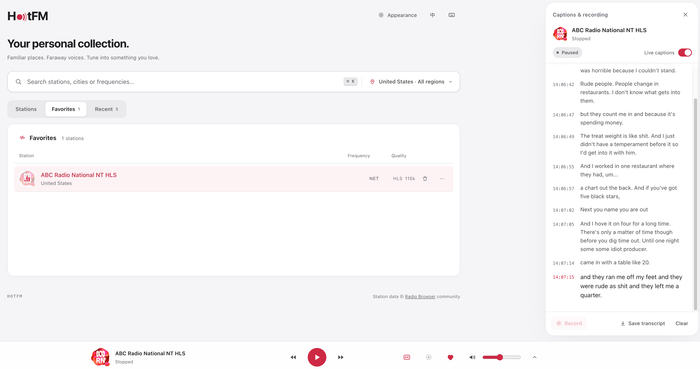

# HotFM

**Familiar places. Faraway voices. Your personal radio collection.**

**English** | [简体中文](README.zh-CN.md)

HotFM is a **free** web radio player with **8,000+ live stations from the United States and mainland China**. Find a familiar station, explore another city, or follow an English broadcast with live captions. It all runs in your browser, with no account and no subscription.



## Why HotFM

- 🆓 **Free.** No subscription, no premium tier, and no ads.
- 🙅 **No sign-up.** Open the page and press play. Favorites and history stay in your browser.
- 📻 **8,000+ stations.** About 6,000 US and 1,800 mainland China stations, searchable by name, city, genre, or frequency.
- 💬 **Free live captions for English radio.** Speech recognition runs on your own device: **no API key, no per-minute fees, and no audio sent to the cloud**.
- 🎙️ **Record and keep what you hear.** Save up to 3 hours of a broadcast with its transcript (`.txt` + time-aligned `.srt`), then replay it with synced captions.
- 🎧 **Built for English listening practice.** Real conversations from US radio, a full-screen reading view, and click-to-seek replay.
- 🏠 **Easy to self-host.** One executable or one `docker compose up`, backed by SQLite, with no external services to set up.

## Make radio part of your day

Keep music on while you work, catch up with voices from home, or practice listening to English as it is spoken on air. HotFM brings discovery, listening, and saving what you hear into one place.

### Find something worth listening to

- Search by station name, city, genre, or frequency, such as `KEXP`, `Seattle`, or `97.4`.
- Choose a country and state or province directly from the search bar. Region lookup accepts Chinese, English, pinyin, and US state abbreviations.
- Browse by popularity or frequency. Search covers the full catalog in your selected region, with support for partial names and minor English typos.
- If nothing matches, expand your search across all supported regions. Recent searches make it easy to revisit a discovery.
- Duplicate listings for the same broadcast are merged, so each station appears once.

### Settle in and keep listening

- Start a station with one click. The player stays at the bottom while you browse, search, or open your favorites.
- Adjust volume, mute, switch stations, and see the current song or program when the station provides it.
- Set a **15, 30, 60, or 90-minute sleep timer** for evening listening.
- On a phone, tap the compact player to open its controls. On desktop, use keyboard shortcuts to control playback without reaching for the mouse.
- Interrupted streams reconnect automatically, and playback resumes on its own when your network comes back.
- When a station cannot play, the player tells you why and offers **Retry** or the next station.

### Build your personal collection

- Save stations to **Favorites** and return to your last **10 recently played stations**.
- Removing a favorite, or clearing the recent list, can be undone right away.
- Export your favorites to a JSON file and import them in another browser.
- Favorites, listening history, volume, and appearance preferences stay in the current browser, with no sign-up. They do not sync between devices.
- Copy a station link from its menu to share it or open it again later.

### Follow English broadcasts with live captions

Open **CC** on desktop to read along in a side panel while the station plays. Timestamped captions help you follow a conversation and look back at a phrase you missed.

- Text updates as speech is recognized, then settles into transcript lines.
- Scroll back through the conversation and jump to the latest caption when ready.
- Expand to a **full-screen reading view** that lays the transcript out as easy-to-read paragraphs.
- Save the transcript as a `.txt` file for later reading or language practice.
- Recognition uses Whisper **on your device**, so there is no API key, no usage bill, and no audio sent to a cloud transcription service. The first use downloads a speech model, which the browser caches for later sessions.
- Turning on captions or recording does not interrupt a playing station.

Live captions currently support **English stations on desktop browsers**. Recognition speed and accuracy depend on your device and the broadcast audio.

### Keep the moments you want to revisit

Record the current station from the player or the captions panel, then download it for later listening.

- See recording duration and file size as you listen.
- English stations are transcribed automatically during recording, even when live captions are switched off.
- Download a ZIP containing the audio, `transcript.txt`, and an audio-aligned `transcript.srt`, or just the audio when no transcript is available.
- **Replay with captions:** open a downloaded ZIP (or drop an audio file with its `.srt`) in the full-screen view. The sentence being spoken is highlighted, clicking any sentence jumps there, and you can skip ±15 seconds or change the playback speed.
- Recordings stop when you stop playback, switch stations, or reach the **3-hour limit**.

Recording is available on supported desktop browsers. Audio is saved as WebM, Ogg, or M4A depending on browser support. Download recordings and transcripts before leaving the page; they are kept only for the current session.

### Make it feel like your radio

Choose the clean **Default** appearance with light, dark, or system color mode, or switch to **Classic Hi-Fi** for a receiver-style interface with a tuning dial and signal meter. The dial supports dragging, scrolling, and keyboard tuning, with optional radio static between stations. The interface is available in **English and Simplified Chinese**.

## Your first listen

1. Choose a country or region, then browse or search for a station.
2. Click a station to play it and tap the heart to save it.
3. On desktop, open **CC** for an English broadcast or **Record** to keep a segment.
4. Download your transcript or recording from the side panel when finished.

<details>
<summary>Keyboard shortcuts</summary>

| Key | Action |
| --- | --- |
| `Space` | Play / stop |
| `/`, `⌘K`, or `Ctrl+K` | Search stations |
| `L` | Choose a region |
| `F` | Toggle favorite |
| `↑` / `↓` | Adjust volume |
| `M` | Mute / unmute |
| `←` / `→` | Tune by 0.1 MHz |
| `Shift` + `←` / `→` | Seek a station |
| `T` | Show / hide the tuning dial |
| `?` | Open the shortcuts panel |

</details>

## Run HotFM locally

Requires **Go 1.24+**, **Node.js 22+**, and **pnpm**.

```bash
git clone https://github.com/tianhongw/hotfm.git
cd hotfm
pnpm --dir web install
make dev
```

Open [localhost:18348](http://localhost:18348). The API runs on port `18347`; `Ctrl+C` stops both services. On first launch, HotFM downloads the station catalog from [Radio Browser](https://www.radio-browser.info). Stations appear as the initial sync completes; timing depends on your connection.

## Self-hosting and development

HotFM uses a Go backend, a React + TypeScript interface, and SQLite storage. The backend maintains the station catalog and handles streams when a proxy is needed. Captions use Whisper in the browser. A production build embeds the interface into a single executable.

```bash
# Build and run the standalone app at http://localhost:18347
make build
./bin/hotfm

# Or build and run with Docker Compose, keeping station data in a named volume
# and rotating container logs (3 × 10 MB)
docker compose up -d --build
```

Use HTTPS when hosting beyond localhost so browser features such as captions can work.

<details>
<summary>Configuration and development reference</summary>

All settings use environment variables; the defaults work for local use.

| Variable | Default | Purpose |
| --- | --- | --- |
| `HOTFM_ADDR` | `:18347` | Server listen address |
| `HOTFM_API` | `http://localhost:18347` | API target for the Vite development proxy; update alongside `HOTFM_ADDR` when changing the API port |
| `HOTFM_DATA_DIR` | `./data` | Database and station logo cache directory |
| `HOTFM_SYNC_INTERVAL` | `24h` | Station catalog refresh interval |
| `HOTFM_STREAM_MODE` | `auto` | Play ordinary HTTPS audio directly where possible; `proxy` routes all streams through the server |
| `HOTFM_MAX_STREAMS_PER_IP` | `4` | Concurrent proxy stream limit per client IP |
| `HOTFM_MAX_SUBSCRIPTIONS_PER_IP` | `4` | Concurrent now-playing/stream-metadata subscriptions per client IP |
| `HOTFM_MAX_METADATA_WATCHERS` | `64` | Concurrent now-playing connections the server keeps for directly streamed stations; `0` means unlimited |
| `HOTFM_SECRET` | Random | Signing key for HLS proxy URLs; set a shared value for multiple instances |
| `HOTFM_TRUST_PROXY` | Off | Set to `1` to trust `X-Forwarded-For` behind a reverse proxy |
| `HOTFM_RADIOBROWSER_URL` | Automatic discovery | Use a specific Radio Browser API mirror |
| `HOTFM_USER_AGENT` | HotFM identifier | User-Agent used for upstream requests |
| `HOTFM_DEBUG` | Off | Set to `1` for debug logs |
| `HOTFM_DEV_CORS` | Off | Set to `1` to allow cross-origin requests during development |

In `auto` mode, HTTP audio and HLS streams still use the proxy. Captions and recording also route the active stream through the server so the browser can process its audio.

- `make dev-api` / `make dev-web`: start either development service separately.
- `make test`: run backend and frontend tests, plus TypeScript checks.
- `make gen`: regenerate frontend API types after changing [`server/api/openapi.yaml`](server/api/openapi.yaml).
- [`server/`](server/) contains the API, station catalog, stream handling, and availability checks; [`web/`](web/) contains the interface, player, captions, and recording.

</details>

## Credits

Station listings come from the community-maintained [Radio Browser](https://www.radio-browser.info). Availability and station details depend on those listings and the broadcasters' streams. Playback reports station clicks to Radio Browser to help maintain popularity rankings.

The Classic Hi-Fi display uses [DSEG fonts](https://github.com/keshikan/DSEG), licensed under SIL OFL 1.1.
