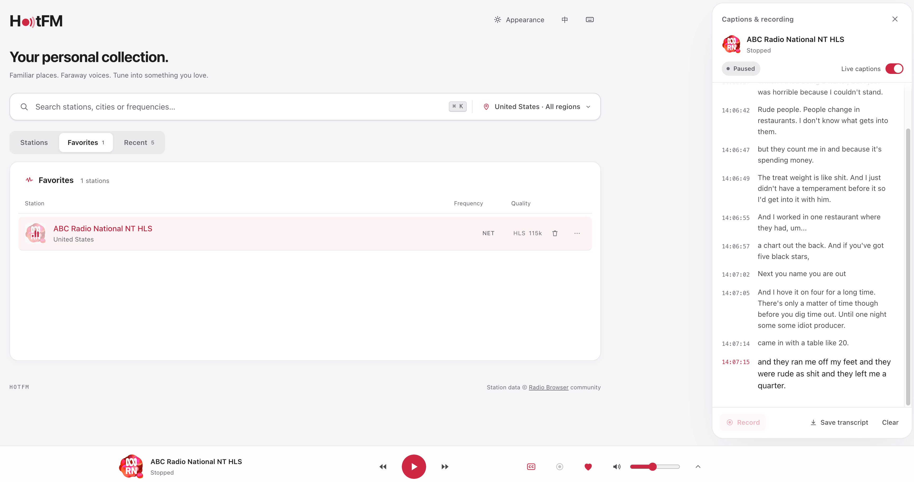

# HotFM

**熟悉的地方，远方的声音。收藏属于你的电台。**

[English](README.md) | **简体中文**

HotFM 是一款浏览器里的网络收音机，支持发现和收听**美国与中国大陆**的电台。找到熟悉的频道，听听另一座城市的日常，或配合实时字幕跟上英语广播——打开浏览器即可使用，无需注册账号。



## 让电台融入你的日常

工作时听音乐，想家时听熟悉的声音，练听力时接触真实的英语对话。HotFM 把找台、收听和保存内容放在一起，让你从听见一段广播，到留下想回顾的片段。

### 更容易找到想听的电台

- 按电台名称、城市、流派或频率搜索，例如 `KEXP`、`Seattle`、`97.4`。
- 在搜索栏直接切换国家和省州。查找地区时支持中文、英文、拼音和美国州缩写。
- 按热门或频率浏览；搜索覆盖所选地区的完整目录，支持部分名称和少量英文拼写错误。
- 没找到结果时，可扩大到所有支持的地区搜索；最近搜索让你方便地回到之前的发现。

### 舒服地听下去

- 点击电台即可播放。浏览列表、搜索或查看收藏时，底部播放器始终保留。
- 随时调整音量、静音和切台；电台提供相关信息时，可查看当前歌曲或节目名称。
- 提供 **15、30、60、90 分钟睡眠定时**，适合睡前收听。
- 手机上点击迷你播放器展开控制；桌面端可用快捷键完成常用操作。
- 自动检查电台可用性，并在播放中断时尝试重新连接。

### 建立自己的电台收藏

- 一键加入**收藏**，也可以从**最近收听**找回最近播放的 10 个电台。
- 收藏、收听历史、音量和外观偏好保存在当前浏览器，无需登录；目前不跨设备同步。
- 从电台菜单复制链接，分享给朋友或留待下次打开。

### 跟着实时字幕听英语广播

在桌面端打开 **CC**，就能边听边看侧边栏中的字幕。带时间标记的文字方便跟上对话，也方便回头查看刚才没听清的表达。

- 说话过程中逐步显示识别结果，再整理成完整的字幕行。
- 向上翻阅之前的对话，随时回到最新字幕。
- 将转写内容保存为 `.txt`，用于回顾内容或练习听力。
- 语音识别在本机完成，**无需 API Key，也不会把音频发送到云端转写服务**。首次使用会下载语音模型，之后由浏览器缓存复用。

实时字幕目前支持**桌面浏览器上的英语电台**。识别速度和准确率会受到设备性能与广播音质影响。

### 留下想再听一遍的片段

从播放器或字幕面板开始录制当前电台，结束后下载，方便之后再次收听。

- 录制时可查看时长和文件大小。
- 录制英语电台时自动生成字幕，即使没有打开实时字幕开关也会转写。
- 有转写内容时，可下载包含音频、`transcript.txt` 和与音频时间对齐的 `transcript.srt` 的 ZIP 压缩包；没有转写内容时直接下载音频。
- 停止播放、切换电台或达到 **3 小时上限**时，录音会自动结束。

录音适用于支持相关能力的桌面浏览器，音频格式根据浏览器支持情况为 WebM、Ogg 或 M4A。录音和字幕只保留在当前会话中，请在离开页面前下载需要的内容。

### 选一种喜欢的收音机外观

**默认外观**提供简洁的列表与播放器，支持浅色、深色和跟随系统；**经典 Hi-Fi 外观**保留收音机造型、调谐刻度盘和信号表。刻度盘支持拖动、滚轮和键盘调台，还可以开启台间噪声，找回转动收音机旋钮的感觉。界面支持**简体中文和英文**。

## 开始第一次收听

1. 选择国家或地区，浏览列表或搜索一个电台。
2. 点击电台播放，点爱心加入收藏。
3. 在桌面端收听英语广播时打开 **CC**，或点击**录音**保存片段。
4. 结束后，在侧边面板下载字幕或录音。

<details>
<summary>键盘快捷键</summary>

| 按键 | 操作 |
| --- | --- |
| `Space` | 播放 / 停止 |
| `/`、`⌘K` 或 `Ctrl+K` | 搜索电台 |
| `L` | 选择地区 |
| `F` | 收藏 / 取消收藏 |
| `↑` / `↓` | 调整音量 |
| `M` | 静音 / 取消静音 |
| `←` / `→` | 按 0.1 MHz 微调 |
| `Shift` + `←` / `→` | 搜台 |
| `T` | 显示 / 隐藏刻度盘 |
| `?` | 打开快捷键面板 |

</details>

## 在本地运行

需要 **Go 1.24+**、**Node.js 22+** 和 **pnpm**。

```bash
git clone https://github.com/tianhongw/hotfm.git
cd hotfm
pnpm --dir web install
make dev
```

打开 [localhost:18348](http://localhost:18348)。API 运行在 `18347` 端口，按 `Ctrl+C` 会同时停止前后端。首次启动会从 [Radio Browser](https://www.radio-browser.info) 同步电台目录，初次同步完成后即可看到电台，耗时取决于网络连接。

## 自行部署与开发

HotFM 使用 Go 后端、React + TypeScript 界面和 SQLite 存储。后端维护电台目录，并在需要时代理音频流；字幕通过浏览器内的 Whisper 完成识别。正式构建会将前端内嵌到单个可执行文件中。

```bash
# 构建并运行独立应用，访问 http://localhost:18347
make build
./bin/hotfm

# 或使用 Docker 构建运行，通过命名卷保留电台数据
docker build -t hotfm .
docker run -p 18347:18347 -v hotfm-data:/data hotfm
```

部署到 localhost 以外的地址时，请使用 HTTPS，以便字幕等浏览器功能正常工作。

<details>
<summary>配置与开发参考</summary>

所有配置通过环境变量设置，默认值即可用于本地运行。

| 变量 | 默认值 | 用途 |
| --- | --- | --- |
| `HOTFM_ADDR` | `:18347` | 服务监听地址 |
| `HOTFM_API` | `http://localhost:18347` | Vite 开发代理的 API 地址；修改 API 端口时需与 `HOTFM_ADDR` 同步调整 |
| `HOTFM_DATA_DIR` | `./data` | 数据库与台标缓存目录 |
| `HOTFM_SYNC_INTERVAL` | `24h` | 电台目录更新间隔 |
| `HOTFM_STREAM_MODE` | `auto` | 尽可能直连普通 HTTPS 音频；设为 `proxy` 时全部经服务端转发 |
| `HOTFM_MAX_STREAMS_PER_IP` | `4` | 每个客户端 IP 的代理流并发上限 |
| `HOTFM_SECRET` | 随机生成 | HLS 代理地址签名密钥；多实例部署时使用同一个固定值 |
| `HOTFM_TRUST_PROXY` | 关闭 | 在反向代理后设为 `1`，信任 `X-Forwarded-For` |
| `HOTFM_RADIOBROWSER_URL` | 自动发现 | 指定 Radio Browser API 镜像 |
| `HOTFM_USER_AGENT` | HotFM 标识 | 访问上游时的 User-Agent |
| `HOTFM_DEBUG` | 关闭 | 设为 `1` 输出调试日志 |
| `HOTFM_DEV_CORS` | 关闭 | 设为 `1` 允许开发时的跨域请求 |

`auto` 模式下，HTTP 音频和 HLS 仍走代理；开启字幕或录音时，当前音频流也会经服务端转发，供浏览器处理音频。

- `make dev-api` / `make dev-web`：单独启动后端或前端开发服务。
- `make test`：运行后端与前端测试，以及 TypeScript 检查。
- `make gen`：修改 [`server/api/openapi.yaml`](server/api/openapi.yaml) 后重新生成前端 API 类型。
- [`server/`](server/) 包含 API、电台目录、音频流处理和可用性检查；[`web/`](web/) 包含界面、播放器、字幕与录音。

</details>

## 数据来源与致谢

电台目录来自社区维护的 [Radio Browser](https://www.radio-browser.info)，可用性和电台信息取决于社区数据及电台自身的音频源。播放时会向 Radio Browser 上报电台点击，以帮助维护热度排序。

经典 Hi-Fi 界面使用 [DSEG 数码管字体](https://github.com/keshikan/DSEG)，遵循 SIL OFL 1.1 许可。
